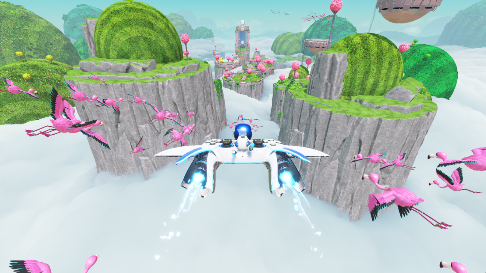
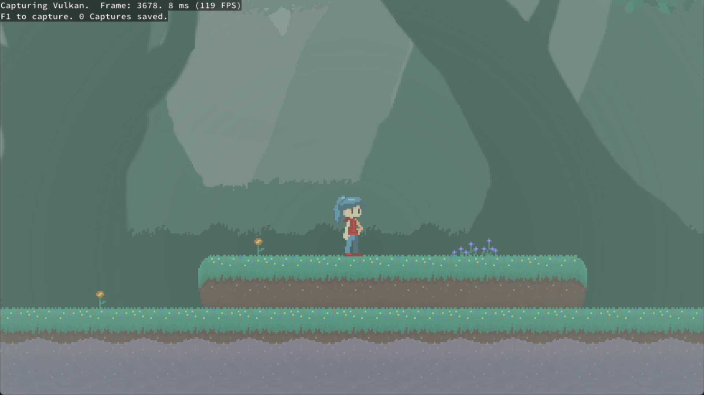
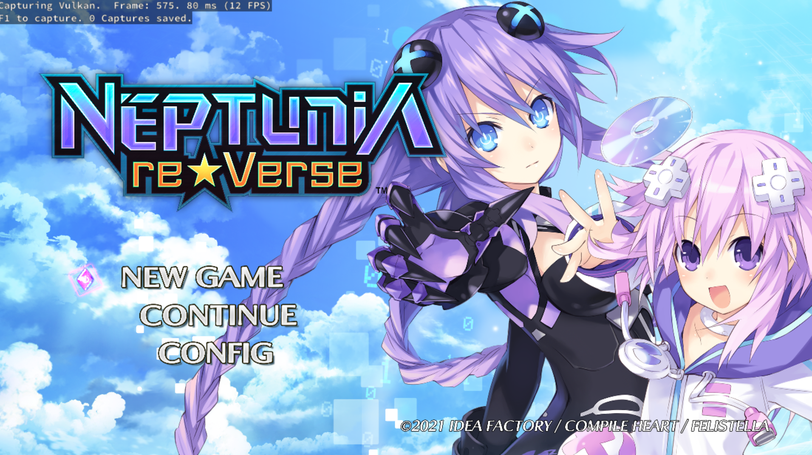
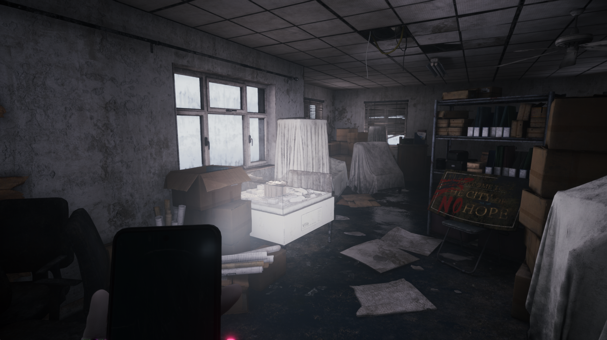
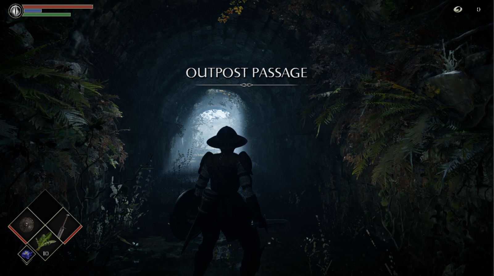

# KytyPS5-AGS

A modified build of the [KytyPS5](https://github.com/Jetsku/KytyPS5) PlayStation 5 emulator,
packaged as an emulator extension for [AGS](https://github.com/ali-commits) (a game host that
streams to phones, laptops and TVs). It carries its own compatibility, stability and performance
work on top of upstream, plus the adapter that lets AGS list, configure, launch and capture games.

The emulator also runs on its own: the Qt launcher (`kyty_launcher`) is kept as a standalone app.

## What this build adds

- **Renderer and compatibility:** the U59 renderer, the Demon's Souls shader and compatibility
  fixes, software ray tracing for compute kernels that use `IMAGE_BVH_INTERSECT_RAY` (Astro Bot
  lighting), and selected upstream int20 and int21 ports.
  See [U59 changes](docs/CHANGES-U59.md), [ported fixes](docs/PORTED-OCT25.md) and the
  [change catalog](docs/CHANGE-CATALOG.md).
- **Performance and stability:** profile-guided builds, pipeline look-ahead with fast-first
  compilation, frame pacing and efficiency work, and crash and hang investigations.
  See [gaming efficiency](docs/GAMING-EFFICIENCY-OCT26.md),
  [pipeline prefetch](docs/PIPELINE-PREFETCH-FAST-FIRST.md),
  [int21 stability](docs/INT21-STABILITY-OCT25.md) and the [hang watchdog](docs/HANG-WATCHDOG.md).
- **Controllers:** DualSense audio, haptics and gyro through the virtual controller AGS provides
  ([controller audio](docs/dualsense-controller-audio.md)).
- **AGS integration:** the `kyty-ags-adapter` (library, settings, cheats, trophies, additional
  content, metrics), frames shared with the AGS capture path, and the session socket
  ([AGS session](docs/AGS_SESSION.md)). Resolution, frame rate, full screen, hide cursor and HDR
  come from AGS settings. HDR stays off for now: the AGS stream is 8-bit SDR, and HDR output from
  this emulator currently looks clipped.

Release notes: [docs/release-notes.md](docs/release-notes.md).

## Install

In AGS open **Settings**, **Emulators**, **Add emulator**, paste
`https://github.com/ali-commits/KytyPS5-AGS` and confirm. AGS installs the latest release package
(Linux x86_64) and keeps your existing saves, trophies and settings when you point the
`runtime_root` setting at an existing KytyPS5 folder. Details, source builds and the release steps
are under [Install as an AGS extension](#install-as-an-ags-extension).

To build it yourself, clone with submodules:

```bash
git clone --recurse-submodules https://github.com/ali-commits/KytyPS5-AGS.git
```

and follow [Building](#building).

## Upstream

Development follows [Jetsku/KytyPS5](https://github.com/Jetsku/KytyPS5), which is based on
[Kyty](https://github.com/InoriRus/Kyty). Upstream fixes are ported selectively and tested before
they land here, so this build is not a copy of upstream `main`. The sections below come from the
upstream project; its links (status, compatibility list, Discord) refer to upstream.

KytyPS5 is a free and open-source PlayStation 5 emulator written in C++ for Windows and Linux,
with experimental macOS support. It is based on a heavily modified version of
[Kyty](https://github.com/InoriRus/Kyty). The project is in active development, and behavior
can change significantly between builds.

> [!IMPORTANT]
> KytyPS5 is not affiliated with Sony Interactive Entertainment or PlayStation. The project does
> not distribute games or copyrighted system software. Use only game files that you have obtained
> legally.

## Current Status

KytyPS5 can boot 2D games and a selection of 3D games, including titles built with Unreal Engine
4/5, Unity, and custom engines. External low-level emulation modules are neither required nor
planned.

Development is currently focused on expanding game compatibility and improving boot reliability.

Windows and Linux are the primary platforms and receive the most testing.

macOS support is experimental. The emulator is built for x86-64 and runs on Apple Silicon under
Rosetta 2, with Vulkan provided by MoltenVK. A small number of titles have been verified in-game
on Apple Silicon hardware; see [Building on macOS](#building-on-macos).

Community game test results are available in the
[KytyPS5 Compatibility List](https://kytyps5.github.io/).

## Bugs and Issues

Compatibility, stability, and performance can vary between versions. You may encounter crashes
or graphical glitches, so please include the version you tested when reporting an issue.

## Screenshots

<table align="center">
  <tr>
    <td align="center">
      <strong>Astro Bot</strong><br>
      
    </td>
    <td align="center">
      <strong>Dreaming Sarah</strong><br>
      
    </td>
  </tr>
  <tr>
    <td align="center">
      <strong>Neptunia ReVerse</strong><br>
      
    </td>
    <td align="center">
      <strong>SILENT HILL: The Short Message</strong><br>
      
    </td>
  </tr>
  <tr>
    <td align="center">
      <strong>Demon's Souls</strong><br>
      
    </td>
    <td align="center">
      <strong>UFC 6</strong><br>
      
    </td>
  </tr>
</table>

<p align="center"><em>And many more...</em></p>

## Contributing

Testing games and submitting detailed bug reports are useful ways to contribute. Search existing
issues first, then use the **Game Emulation Status Report** template and attach the complete log file.

Code contributions should be focused, build successfully on the platforms they touch, and include
relevant tests where practical. Windows is the primary target, so a change that alters shared code
should not regress it; changes confined to a platform's own code paths only need to build there. Because KytyPS5 is still evolving quickly, consider opening an issue before
starting a large change.

### Formatting

Set up the clang-format hook after cloning:

Install `pre-commit` using the method appropriate for your platform:

- **Arch Linux / CachyOS:** `sudo pacman -S pre-commit`
- **Other Linux / macOS / Windows:** `python -m pip install pre-commit`

Then install the Git hook:

```bash
python -m pre_commit install --install-hooks
```

It formats staged `.cpp`, `.h`, and `.inc` files in `src`.

## Developer Information

The PS5 graphics architecture is based on AMD RDNA 2. Use AMD's
[RDNA 2 Instruction Set Architecture Reference Guide (document 70648)](https://docs.amd.com/v/u/en-US/rdna2-shader-instruction-set-architecture)
as the primary instruction-encoding reference when working on shader decoding and recompilation.

Important areas of the codebase:

- [`src/graphics/shader/recompiler`](src/graphics/shader/recompiler) — instruction decoding,
  intermediate representation, control flow, resource tracking, and SPIR-V emission
- [`src/graphics/guest_gpu`](src/graphics/guest_gpu) — PS5 (Prospero) GPU formats and command processing
- [`src/graphics/host_gpu`](src/graphics/host_gpu) — Vulkan host backend and resource management
- [`tests`](tests) — focused memory, shader, and resource-tracking regression tests

The renderer targets Vulkan 1.3. Keep shader changes aligned with both the RDNA 2 ISA semantics and
the Vulkan/SPIR-V validation rules.

## Building

### System requirements

- Windows 10 version 1803, a current Linux distribution, or macOS on Apple Silicon
- A 64-bit x86 processor (on macOS, an Apple Silicon processor with Rosetta 2)
- A Vulkan 1.3-capable GPU with current drivers (on macOS, Vulkan is provided by the bundled
  MoltenVK)

### Build requirements (Windows)

- Git
- CMake 3.22.1 or newer
- Ninja
- Visual Studio 2022 or Build Tools 2022 with the **Desktop development with C++** workload and
  **C++ Clang tools for Windows** component
- Qt 6 for MSVC 2022 64-bit, including Concurrent, Network, and Widgets
- [glslang](https://github.com/KhronosGroup/glslang/releases) (`glslangValidator`) on `PATH`

The Microsoft C++ compiler (`cl.exe`) is not supported; use `clang-cl`.

Open an **x64 Native Tools Command Prompt for Visual Studio 2022** (or the equivalent Developer
PowerShell), change to the repository root, and initialize the dependencies:

```powershell
git submodule update --init --recursive
```

Configure the project. Replace the Qt path with the version installed on your system:

```powershell
cmake -S . -B _Build/windows -G Ninja -DCMAKE_BUILD_TYPE=Release -DCMAKE_C_COMPILER=clang-cl -DCMAKE_CXX_COMPILER=clang-cl -DCMAKE_PREFIX_PATH="C:/Qt/6.x.x/msvc2022_64"
```

Build the launcher and stage a runnable installation:

```powershell
cmake --build _Build/windows --target launcher
cmake --install _Build/windows --prefix _Build/windows/install
```

The finished application and its runtime dependencies will be placed in
`_Build/windows/install`.

### Building on Linux

Install the toolchain and the libraries the bundled SDL3 needs. Without the audio, Wayland and
udev development packages SDL3 quietly configures itself without those backends, and the resulting
build has no working sound and no gamepad hotplug:

```bash
sudo apt-get install --no-install-recommends \
  clang lld ninja-build cmake git glslang-tools pkg-config \
  libgl1-mesa-dev libx11-dev libxcursor-dev libxext-dev libxfixes-dev \
  libxi-dev libxrandr-dev libxss-dev libxtst-dev libxkbcommon-dev \
  libasound2-dev libpulse-dev libudev-dev libdbus-1-dev libwayland-dev wayland-protocols
```

Qt 6 (Concurrent, Network, Widgets) is required for the launcher — either the distribution packages
(`qt6-base-dev`) or an official Qt installation.

```bash
git submodule update --init --recursive

cmake -S . -B _Build/linux -G Ninja -DCMAKE_BUILD_TYPE=Release \
  -DCMAKE_C_COMPILER=clang -DCMAKE_CXX_COMPILER=clang++ \
  -DCMAKE_PREFIX_PATH="$Qt6_DIR"

cmake --build _Build/linux --target kyty_emulator launcher --parallel
cmake --install _Build/linux --prefix _Build/linux/install
```

On machines with limited RAM, pass a smaller `--parallel N`; the emulator sources are large. The
install step copies the Qt libraries and plugins next to the binaries, so
`_Build/linux/install` runs without a matching system Qt. FFmpeg is linked statically
from the pinned [KytyPS5 FFmpeg core](https://github.com/KytyPS5/ext-ffmpeg-core)
release, including VP9 and WebM support. System FFmpeg packages are not required.

To build `kyty_emulator` and the `kyty_tests` target without Qt, use a separate build directory:

```bash
git submodule update --init --recursive

cmake -S . -B _Build/linux-no-qt -G Ninja -DCMAKE_BUILD_TYPE=Release \
  -DCMAKE_C_COMPILER=clang -DCMAKE_CXX_COMPILER=clang++ \
  -DKYTY_BUILD_LAUNCHER=OFF

cmake --build _Build/linux-no-qt --target kyty_emulator kyty_tests --parallel
```

Core tests (the Linux CI subset from `.github/workflows/build.yml`):

```bash
cmake --build _Build/linux --target kyty_tests
ctest --test-dir _Build/linux --output-on-failure \
  -R '^(audio_out2_port|pad_haptics|controller_settings|host_input|ime_dialog|lru_cache|memory_tracker|page_manager|resource_tracking|scalar_provenance|resource_materialization|shader_vertex_metadata|archive_file|avplayer_file|virtual_memory_allocation)$'
```

As on Windows, the MSVC compiler is not used; Clang is required. `cl.exe` is rejected at configure
time.

The CMake source root is the repository root.

### Building on NixOS

A development shell provides Clang, CMake, Ninja, Qt 6, the Vulkan headers, and the SDL3 backend
libraries. Enter it and configure exactly as on other Linux distributions; the shell exports
`CMAKE_PREFIX_PATH` and `QT_PLUGIN_PATH`, so the `-DCMAKE_PREFIX_PATH="$Qt6_DIR"` argument is not
needed:

```bash
nix-shell # or: nix develop
git submodule update --init --recursive

cmake -S . -B _Build/linux -G Ninja -DCMAKE_BUILD_TYPE=Release \
  -DCMAKE_C_COMPILER=clang -DCMAKE_CXX_COMPILER=clang++

cmake --build _Build/linux --target launcher --parallel
cmake --install _Build/linux --prefix _Build/linux/install
```

The configure step downloads the FFmpeg prebuilts and the `xbyak`, `zydis`, `zstd`, and ZArchive
sources, so it needs network access; a fully sandboxed `nix build` would require vendoring those
inputs. A Vulkan 1.3 driver must be available at runtime (on NixOS,
`hardware.graphics.enable = true`).

### Building on macOS

macOS builds target x86-64 and run under Rosetta 2 on Apple Silicon, so the PS5's x86-64 game
code executes through the same translation layer as the emulator itself. Prebuilt archives are
attached to releases; the steps below are for building from source.

Requirements:

- An Apple Silicon Mac with Rosetta 2 installed (`softwareupdate --install-rosetta`)
- Xcode (or the Command Line Tools)
- Homebrew packages: `brew install cmake ninja glslang`
- Qt 6 (Concurrent, Network, Widgets) with x86-64 support. The official Qt installation is
  universal and works; Homebrew's Qt is arm64-only and will not link

```bash
git submodule update --init --recursive

cmake -S . -B _Build/macos -G Ninja -DCMAKE_BUILD_TYPE=Release \
  -DCMAKE_OSX_ARCHITECTURES=x86_64 \
  -DCMAKE_C_COMPILER=clang -DCMAKE_CXX_COMPILER=clang++ \
  -DCMAKE_PREFIX_PATH="$Qt6_DIR"

cmake --build _Build/macos --target launcher --parallel
cmake --install _Build/macos --prefix _Build/macos/install
```

The build re-signs `kyty_emulator` with the JIT entitlements it needs to execute translated
guest code; no manual signing step is required. When the launcher is built, the install
also produces `_Build/macos/install/KytyPS5.app` — double-click to launch the GUI.
A flat `kyty_emulator` is kept for CLI usage.

Vulkan comes from MoltenVK. Download `MoltenVK-macos.tar` from the
[MoltenVK releases](https://github.com/KhronosGroup/MoltenVK/releases), then copy
`MoltenVK/dynamic/dylib/macOS/libMoltenVK.dylib` next to the flat `kyty_emulator`
(and, for the bundle, into `KytyPS5.app/Contents/Frameworks/`) and ad-hoc sign it:

```bash
codesign --force --sign - _Build/macos/install/libMoltenVK.dylib
# For the bundle (if present):
codesign --force --sign - _Build/macos/install/KytyPS5.app/Contents/Frameworks/libMoltenVK.dylib
codesign --force --sign - _Build/macos/install/KytyPS5.app
```

Release archives already include a signed `libMoltenVK.dylib` (both flat and inside the bundle).

### Regression tests

Build every regression executable and run the registered tests with:

```powershell
cmake --build _Build/windows --target kyty_tests
ctest --test-dir _Build/windows --output-on-failure
```

Use `_Build/linux` instead of `_Build/windows` for a Linux build.

### Visual Studio Code

A ready-made Visual Studio Code setup is included in [`.vscode`](.vscode). It configures CMake
Tools to build the project with Ninja and `clang-cl` and provides launch profiles for both
`launcher.exe` and `kyty_emulator.exe`. It is Windows-only: VS Code settings cannot select a
compiler per platform, so on Linux configure from the command line as shown above.

Before using it:

1. Install the **CMake Tools** and **C/C++** extensions in Visual Studio Code.
2. Update `CMAKE_PREFIX_PATH` in [`.vscode/settings.json`](.vscode/settings.json) to point to your
   Qt 6 MSVC installation.
3. Update the `--game` path in [`.vscode/launch.json`](.vscode/launch.json) for the
   **Debug kyty_emulator** profile.
4. Open the repository in an x64 Visual Studio developer environment, configure the CMake project,
   and select a launch profile from **Run and Debug**.

## Running

Update your graphics driver before reporting rendering problems.

To use the graphical launcher:

```powershell
.\_Build\windows\install\launcher.exe
```

```bash
./_Build/linux/install/kyty_launcher
```

```bash
open _Build/macos/install/KytyPS5.app  # or double-click in Finder
```

On first launch, add one or more game folders in the global settings. The launcher searches those
folders recursively for game directories containing `eboot.bin` and ZArchive (`.zar`) game dumps
whose archive root contains `eboot.bin`. Select a detected game and run it from the game list.
ZArchive dumps are mounted read-only and streamed directly; they do not need to be extracted first.

The emulator can also be started directly with a legally obtained game directory, ELF file, or
ZArchive dump:

```powershell
.\_Build\windows\install\kyty_emulator.exe --game "D:\Games\ExampleGame"
.\_Build\windows\install\kyty_emulator.exe --game "D:\Games\ExampleGame.zar"
```

```bash
./_Build/linux/install/kyty_emulator --game "/games/ExampleGame"
./_Build/linux/install/kyty_emulator --game "/games/ExampleGame.zar"
```

On macOS, the adjacent flat or app-bundled `libMoltenVK.dylib` is found automatically; no
environment variable is required:

```bash
./_Build/macos/install/kyty_emulator --game "/games/ExampleGame"
```

To override the Vulkan loader, set `SDL_VULKAN_LIBRARY`:

```bash
SDL_VULKAN_LIBRARY=/path/to/libMoltenVK.dylib ./kyty_emulator --game "/games/ExampleGame"
```

Run `kyty_emulator --help` to see the available graphics, logging, validation, profiling, and
debugging options.

## Install as an AGS extension

This repository is an AGS emulator extension (`ags-extension.toml`,
adapter `kyty-ags-adapter`). In AGS open **Settings**, **Emulators**,
**Add emulator**, paste `https://github.com/ali-commits/KytyPS5-AGS` and confirm. AGS installs the release
package for the latest release and falls back to a source build when the release has none.

The release package is Linux x86_64 only. On aarch64 there is no matching package, so AGS falls back to a
source build, which is untested.

Building from source (the AGS fallback) needs:

- Qt 6.8 or newer with the Concurrent, Network, Widgets and DBus components, installed system-wide.
  CMake finds Qt only from system paths, so a Qt under `~/Qt` is not used.
- The tools in the manifest `depends` list (cmake, ninja, clang, clang++, ld.lld, glslangValidator, git,
  pkg-config, qmake6) and the development libraries. On Ubuntu:
  `clang glslang-tools libasound2-dev libdbus-1-dev libgl1-mesa-dev libpulse-dev libudev-dev
  libwayland-dev libx11-dev libxcursor-dev libxext-dev libxfixes-dev libxi-dev libxkbcommon-dev
  libxrandr-dev libxss-dev libxtst-dev lld ninja-build pkg-config wayland-protocols` plus the distribution's
  Qt 6 development packages.
- Network access during configure: CMake clones several third-party libraries (SHA-pinned) with git.
- AGS runs the build with only `PATH`, `HOME` and `LANG` in the environment.

To cut a release:

1. Bump `project(... VERSION x.y.z)` in `CMakeLists.txt`.
2. Configure, then copy the rendered manifest to the repository root and commit it:
   `cp _Build/linux/ags-extension.toml ags-extension.toml`. `ctest --test-dir _Build/linux -R ags_manifest`
   fails while the committed copy differs from the manifest rendered from `ags-extension.toml.in`.
   The template is rendered by `configure_file`, so it must not contain other `${...}` or `@VAR@` text.
3. Tag the commit `vx.y.z` (the tag must equal `v` plus the project version) and push the tag. The
   `ags-release.yml` workflow builds, tests and packages the release and uploads
   `kytyps5-ags-<version>-linux-<arch>.tar.zst` and its `.sha256`.

To build the package locally: `tools/package.sh _Build/linux out` after building `launcher`,
`kyty_emulator` and `kyty-ags-adapter`.

### AI Use

AI tools may be used for research, reverse engineering, and development assistance. Contributors
must fully understand, review, and test all code they submit and remain responsible for its
correctness. Repository communication, including pull-request descriptions, code comments, and
issue comments, must come from the human contributor rather than an autonomous AI agent.

Pull requests that include AI-assisted or AI-generated work should disclose the scope of the AI
involvement and describe the human review and testing performed before submission. Unverified or
untested generated changes may be closed without review.

## License

KytyPS5 is licensed under the [GNU General Public License version 2](LICENSE)
(`GPL-2.0-only`).

This project is based on the original [Kyty](https://github.com/InoriRus/Kyty), which was released
under the MIT License. Kyty's original copyright and license notice are preserved in
[`LICENSES/Kyty-MIT.txt`](LICENSES/Kyty-MIT.txt). Third-party components remain subject to the
licenses included with those components.

## Special Thanks

- [InoriRus/Kyty](https://github.com/InoriRus/Kyty) — KytyPS5 is based on a heavily modified version
  of the original Kyty project.
- [shadps4-emu/shadPS4](https://github.com/shadps4-emu/shadPS4) — reference for understanding PS4
  memory behavior, GPU resource aliasing and cache coherency,
  and the AVPlayer implementation.
